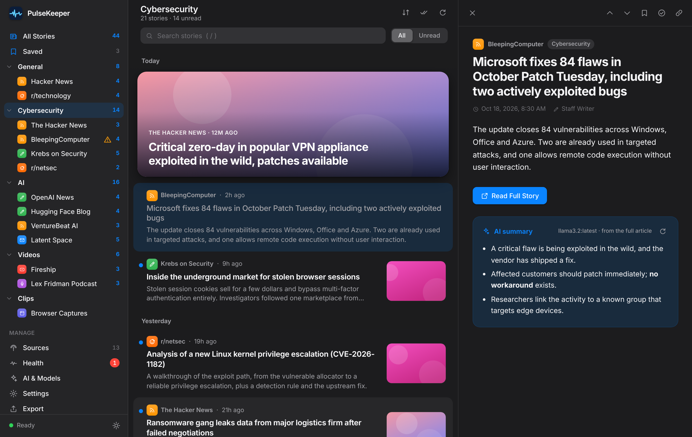
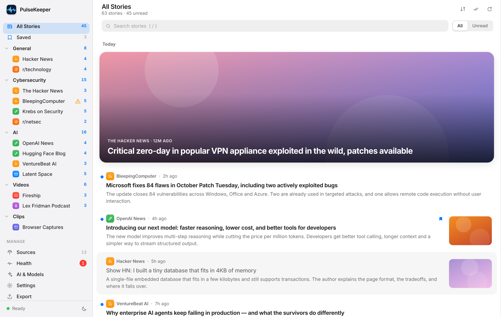
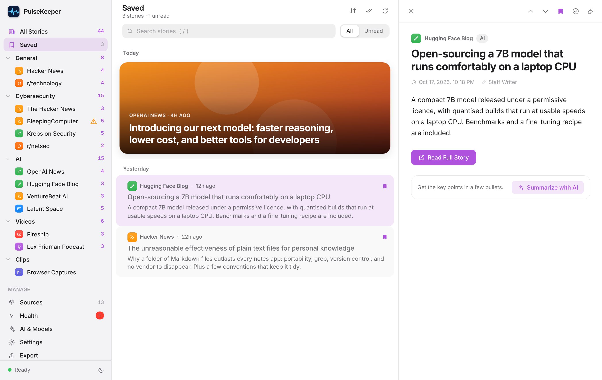
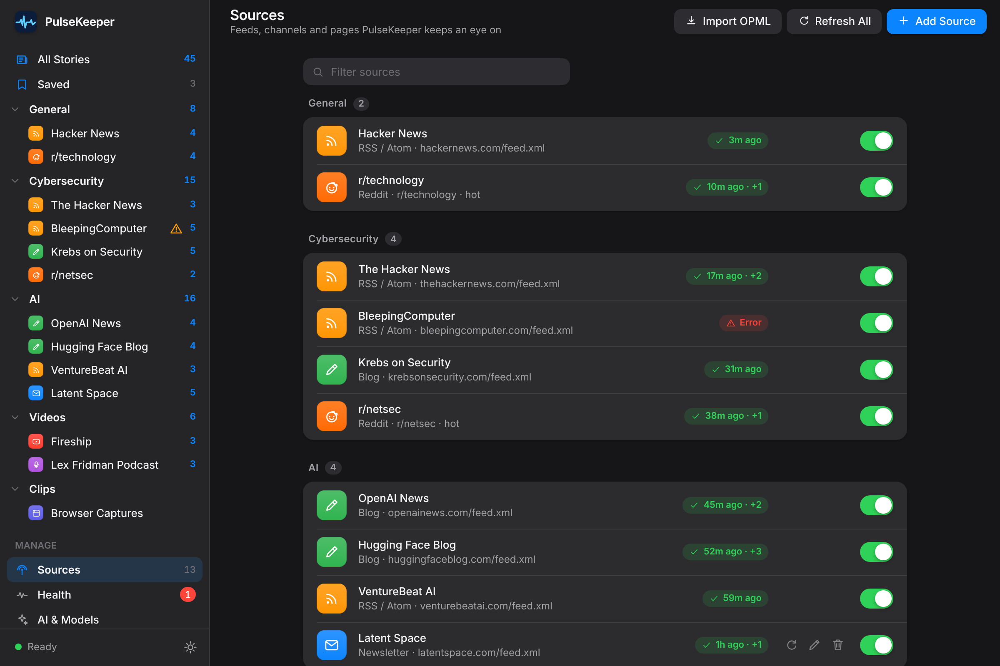
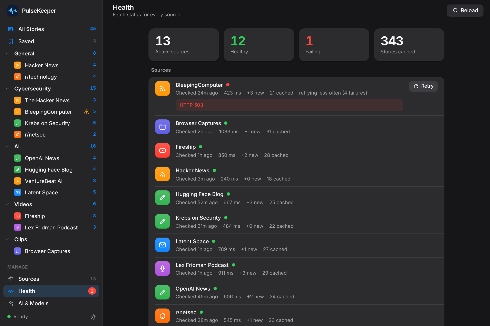
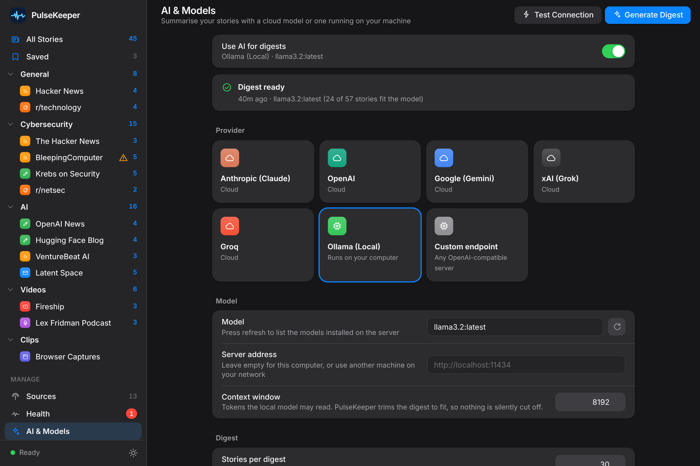
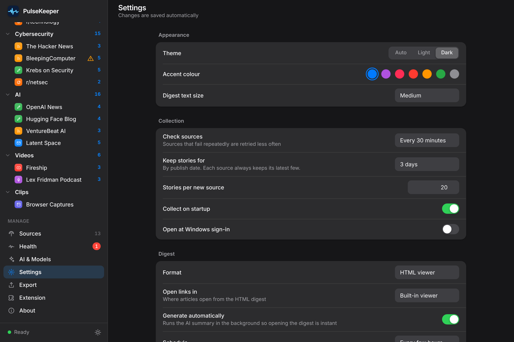
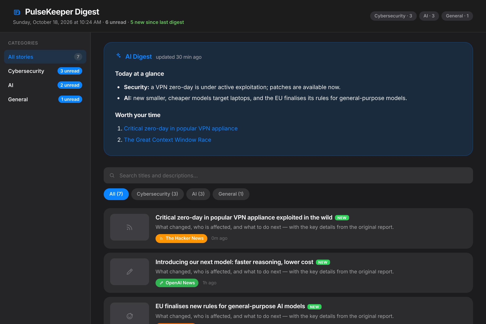
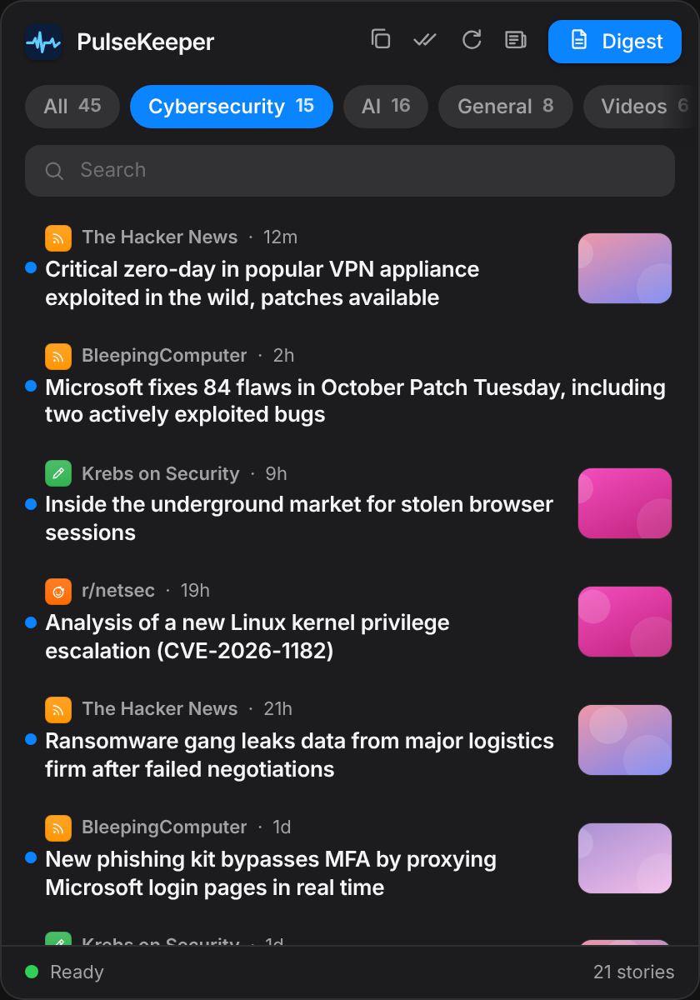
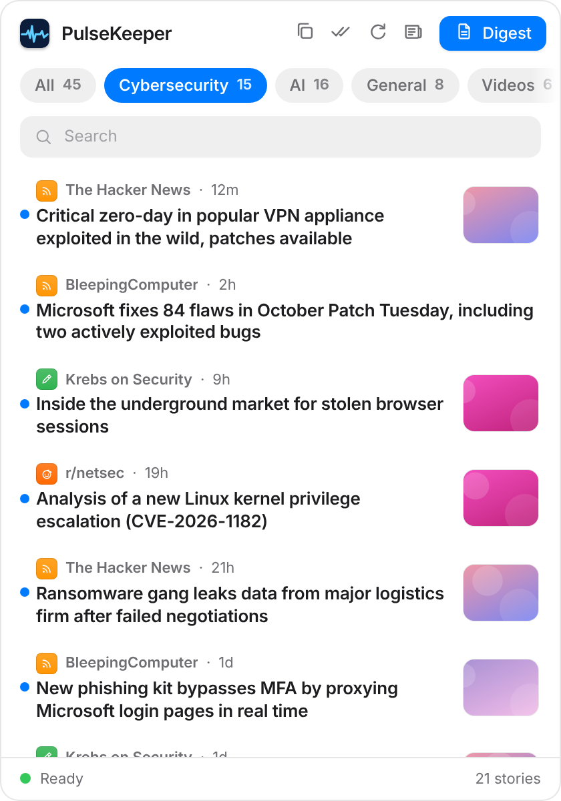

<div align="center">


# PulseKeeper

**A private news aggregator for Windows — every feed you follow in one calm, fast reader, with optional AI summaries from a cloud model or one running on your own machine.**


<br>



</div>

---

## Contents

- [Why PulseKeeper](#why-pulsekeeper)
- [Features](#features)
- [Screenshots](#screenshots)
- [Getting started](#getting-started)
- [Using PulseKeeper](#using-pulsekeeper)
- [Sources](#sources)
- [AI summaries and digests](#ai-summaries-and-digests)
- [Browser extension](#browser-extension)
- [AgentPlatform integration](#agentplatform-integration)
- [Settings](#settings)
- [Privacy and security](#privacy-and-security)
- [How it works](#how-it-works)
- [Data on disk](#data-on-disk)
- [Development](#development)
- [Troubleshooting](#troubleshooting)
- [Credits and license](#credits-and-license)

---

## Why PulseKeeper

Following many sources means many tabs, many apps and a lot of noise. PulseKeeper pulls RSS and Atom feeds, blogs, newsletters, podcasts, YouTube channels, subreddits and arbitrary web pages into **one reader**, keeps them fresh in the background, and lives quietly in the system tray until you want it.

- **Your data stays yours.** Everything is stored as plain JSON in your Documents folder. Collecting content needs no account and no API key.
- **AI is optional and local-friendly.** Summarise a story or a whole day with Anthropic, OpenAI, Gemini, xAI, Groq — or Ollama and any OpenAI-compatible server on your own hardware.
- **Built to be dependable.** Conditional requests, retries, backoff for broken feeds, atomic writes and a backend test suite keep it fast and quiet.

## Features

### Read
- **News aggregator** — one sidebar with *All Stories*, *Saved*, and every **category → source** with live unread counts. Select a category or a single source, then search, filter to unread, and sort by newest, oldest or source.
- **Reader panel** — open a story beside the list, step with the keyboard, mark read or unread, copy the link, or jump to the original.
- **Saved stories** — bookmark anything; saved stories are kept even after they age out of the feed or the source is deleted.
- **AI summary per story** — key points in a few bullets, generated from the full article text when it can be fetched, and cached so reopening is instant.
- **Day grouping, hero story and thumbnails** — a clean, Apple-News-style layout in light or dark.
- **No duplicates** — the same article syndicated by several sources appears once and is read once.

### Collect
- **Eight source types** — RSS/Atom, podcast, YouTube, Reddit, newsletter, blog, web page (CSS-selector scraping) and browser captures.
- **Smart collection** — parallel fetching, conditional requests (ETag / Last-Modified), automatic retries, and exponential backoff for sources that keep failing.
- **Feed discovery** — paste any website address and PulseKeeper finds the feed.
- **OPML import** — bring your whole subscription list; folders become categories.
- **Muted words** — hide noise everywhere, including stories already collected.
- **Per-source schedules** — override the global refresh interval for individual sources.

### Summarise
- **AI digest** — a cached, scheduled summary of everything new, written by the model of your choice.
- **Local models done properly** — native Ollama support with a configured context window; the digest is trimmed to fit instead of being silently cut off. Model lists come straight from the provider.
- **Digest outputs** — HTML viewer, Markdown or PDF, with history.

### Everywhere
- **System-tray app** with an unread badge and a quick-view popup.
- **Browser extension** (Chrome / Edge) to send pages, selections and links to PulseKeeper.
- **Health dashboard** showing every source's status, timing and errors.
- **Apple-style interface** — light, dark or automatic theme, seven accent colours, smooth GSAP motion that respects reduced-motion settings.
- **AgentPlatform export** and a command-line bridge for automation.

## Screenshots

<table>
  <tr>
    <td width="50%"><br><sub><b>Light mode</b> — hero story, day groups, unread dots</sub></td>
    <td width="50%"><br><sub><b>Saved</b> — bookmarks that outlive the feed, here with the purple accent</sub></td>
  </tr>
  <tr>
    <td width="50%"><br><sub><b>Sources</b> — grouped by category with status at a glance</sub></td>
    <td width="50%"><br><sub><b>Health</b> — what is failing, why, and how often it is retried</sub></td>
  </tr>
  <tr>
    <td width="50%"><br><sub><b>AI &amp; Models</b> — cloud providers or a local Ollama server</sub></td>
    <td width="50%"><br><sub><b>Settings</b> — appearance, collection, digest; saved automatically</sub></td>
  </tr>
  <tr>
    <td width="50%"><br><sub><b>Digest</b> — AI summary on top, every story below</sub></td>
    <td width="50%" align="center"> <br><sub><b>Tray popup</b> — a quick look without opening the app</sub></td>
  </tr>
</table>

<sub>Screenshots use sample stories so no real publisher content is reproduced.</sub>

---

## Getting started

### Requirements

- Windows 10 or 11 (x64)
- [Node.js](https://nodejs.org/) 22 or later and npm 10 or later — only when running from source

### Run from source

```powershell
git clone https://github.com/vinitgirdhar/PulseKeeper.git
cd PulseKeeper
npm install
npm start
```

PulseKeeper starts in the **system tray** (bottom-right of the taskbar, behind the `^` arrow). It has no window on launch.

| Tray action | Result |
|---|---|
| **Left-click** | Quick-view popup with the latest stories |
| **Double-click** | Open the digest |
| **Right-click → Open PulseKeeper** | The main window: news, sources, AI, settings |
| **Right-click → Refresh Now** | Fetch every source immediately |

A fresh install comes with a curated set of cybersecurity, AI and general technology sources so there is something to read straight away. Delete or replace them under **Sources**.

### Build an installer

```powershell
npm run build        # NSIS installer + portable exe in dist\
npm run build:dir    # unpacked app folder, fastest way to test a build
```

Binaries are produced with [electron-builder](https://www.electron.build/). Installers are published on the repository's [Releases](https://github.com/vinitgirdhar/PulseKeeper/releases) page when available.

---

## Using PulseKeeper

### The sidebar

| Item | What it shows |
|---|---|
| **All Stories** | Everything from your enabled sources, newest first |
| **Saved** | Stories you bookmarked |
| **Category** (e.g. *Cybersecurity*) | Every source in that category; click the chevron to collapse it |
| **Source** | Just that source, in full |
| **Manage** | Sources, Health, AI &amp; Models, Settings, Export, Extension, About |

Numbers beside each item are **unread** counts and update as you read.

### Reading

Click a story to open it in the reader. Opening a story marks it read. Use the toolbar above the list to **sort**, **mark everything in this view as read**, or **refresh**, and the search box and *All / Unread* switch to narrow the list.

| Key | Action |
|---|---|
| `J` / `↓` | Next story |
| `K` / `↑` | Previous story |
| `Enter` / `O` | Open the original in your browser |
| `S` | Save or unsave |
| `M` | Mark read or unread |
| `/` | Focus search |
| `Esc` | Close the reader |
| `Ctrl` + `R` | Refresh all sources |
| `Ctrl` + `N` | Add a source |
| `Ctrl` + `E` | Open the digest |
| `Ctrl` + `,` | Settings |

### Adding sources

**Sources → Add Source** (or `Ctrl`+`N`). Choose a type, paste the address, optionally give it a name and a **category**, and save — PulseKeeper fetches it straight away. For feeds, **Find Feed** discovers the RSS address behind any website. **Import OPML** adds a whole list at once; folders in the file become categories.

### The tray popup

Left-click the tray icon for the latest 100 stories, filterable by category, with search, *mark all read* (with undo) and *copy as Markdown*. The tray icon shows a dot while there is something new.

---

## Sources

| Type | You provide | API key |
|---|---|---|
| **RSS / Atom** | Feed URL | No |
| **Podcast** | The show's RSS URL | No |
| **YouTube** | Channel URL (`/channel/UC…` is most reliable), `@handle` or playlist URL | No |
| **Reddit** | Subreddit and sort (hot / new / top / rising) | No |
| **Newsletter** | The newsletter's feed (Substack, Beehiiv, Ghost…) | No |
| **Blog** | Feed URL | No |
| **Web page** | URL plus optional CSS selectors for items, title, link and summary | No |
| **Browser capture** | Created automatically by the extension | No |

<details>
<summary><b>Notes on specific sources</b></summary>

- **YouTube** — `https://www.youtube.com/channel/UCxxxxxx` never needs a lookup. `@handle` URLs are resolved through YouTube's public endpoints and the result is remembered. Find a channel ID in YouTube Studio → Settings → Channel → Basic info.
- **Podcast** — paste the public RSS feed; no Spotify or Apple account required. Look on the show's website, [Podchaser](https://podchaser.com) or [Listen Notes](https://listennotes.com).
- **Reddit** — uses the public RSS feed and falls back to the public JSON listing. No Reddit account needed.
- **Web page** — with no selector the whole page is one item that is re-published whenever its text changes (a simple change monitor). With a selector each match becomes an item.
- **Failing sources** — after three consecutive failures a source is retried less often (up to every six hours) so a dead feed is never hammered. *Refresh now* on the source always tries immediately.

</details>

### How long stories are kept

Stories are kept by **publish date** for the number of days set in Settings → *Keep stories for*. Each source always keeps its newest few stories, so a blog that posts monthly is never empty. **Saved** stories are kept indefinitely.

---

## AI summaries and digests

AI is entirely optional. Turn it on under **AI &amp; Models**.

| Provider | Needs a key | Notes |
|---|---|---|
| **Anthropic** (Claude) | Yes | |
| **OpenAI** | Yes | Reasoning models (o-series, GPT-5) are handled automatically |
| **Google** (Gemini) | Yes | |
| **xAI** (Grok) | Yes | |
| **Groq** | Yes | |
| **Ollama** | No | Local. Leave the server address empty for this computer, or enter another machine's address |
| **Custom endpoint** | Optional | Any OpenAI-compatible server — LM Studio, vLLM, LiteLLM, llama.cpp… |

API keys are remembered **per provider**, so switching providers does not lose them. Use the refresh button beside *Model* to list the models your account (or your Ollama server) actually offers, and **Test Connection** to verify everything before generating.

### Story summaries

Open a story and choose **Summarize with AI**. PulseKeeper fetches the article page (best effort), extracts the readable text, and asks the model for three to five bullet points. The summary streams into the reader and is cached, so you only pay for it once; the refresh icon regenerates it. If the page cannot be read, the feed's preview text is used instead and the card says so.

### Daily digest

**Generate Digest** (or a schedule under Settings → *Generate automatically*) summarises your newest stories into one Markdown digest, cached so opening it is instant. The digest is also available as a styled HTML page, Markdown file or PDF from **Export**, and every one is archived in the history.

### Running a local model

1. Install [Ollama](https://ollama.com) and pull a model, for example `ollama pull llama3.2`.
2. In **AI &amp; Models** choose **Ollama (Local)**, press the refresh button beside *Model* and pick the model.
3. Press **Test Connection**.

Tips for local models:

- **Context window** (default 8192 tokens) is sent to Ollama, and PulseKeeper only packs as many stories as fit, so nothing is silently truncated. Raise it if your hardware allows.
- **Stories per digest** is the biggest speed lever on CPU — fewer stories means much less to read before the first word.
- **Request timeout** counts *silence*, not total time: a long generation is never cut off while it is still producing text.
- Reasoning models that emit `<think>…</think>` have that text removed from the result.

---

## Browser extension

The Chrome / Edge (Manifest V3) extension sends the current page, a selection or a link to PulseKeeper's **Browser Captures** source.

1. In PulseKeeper open **Extension** and choose **Open Extension Folder**. (The files are copied to `%USERPROFILE%\Documents\PulseKeeper\extension\` on every start.)
2. Open `chrome://extensions` or `edge://extensions` and turn on **Developer mode**.
3. Choose **Load unpacked** and select that folder.

Then right-click a page, selection or link and choose **Send to PulseKeeper**, or click the toolbar icon. The extension talks to a server that listens **only on `127.0.0.1:7828`** and accepts captures **only from the extension itself**. PulseKeeper must be running for captures to arrive; the Extension page shows the server status.

## AgentPlatform integration

PulseKeeper can export an agent pack for [AgentPlatform](https://github.com/rod-trent/AgentPlatform) — **Export → Export Agent Pack** produces a JSON file with two chained agents: a *Content Collector* that runs `scripts/pk-bridge.js` to read the cached stories, and an *AI Digest* agent that summarises them with your configured model.

`pk-bridge.js` also works on its own:

```powershell
node scripts\pk-bridge.js --format markdown --max 40
```

| Flag | Values | Default |
|---|---|---|
| `--format` | `text`, `markdown`, `json` | `text` |
| `--max` | number of stories | `30` |

## Settings

Everything under **Settings** is saved automatically.

| Section | Highlights |
|---|---|
| **Appearance** | Auto / Light / Dark, seven accent colours, digest text size |
| **Collection** | Check interval, how long to keep stories, stories per new source, collect on startup, open at Windows sign-in |
| **Digest** | Format, where article links open, scheduled generation (every N hours or daily), history length |
| **Notifications** | Windows toasts, notify after every refresh |
| **Muted words** | Comma-separated; hides matching stories everywhere, reversibly |
| **Backup** | Export or import sources, settings and saved stories as one JSON file |

---

## Privacy and security

- **Local first.** Sources, settings, read state, saved stories and summaries live in `Documents\PulseKeeper\`. Nothing is uploaded anywhere.
- **What does leave your machine:** requests to the feeds and pages you subscribe to; story text sent to your chosen AI provider *only* when you generate a digest or summary (nothing is sent with a local model); and thumbnails, which your computer loads directly from each publisher like any browser would.
- **API keys** are stored in `settings.json` on your machine. Treat that file, and any backup export that includes it, as sensitive.
- **Untrusted content is treated that way.** Feed text is escaped before it is displayed; only `http`, `https` and `mailto` links are ever handed to Windows; the renderer runs with context isolation, no Node integration and a strict content-security policy with no inline scripts.
- **The capture server** binds to localhost and rejects writes from anything but the browser extension, so a web page cannot inject stories.

---

## How it works

```
 ┌──────────────┐  schedule / manual   ┌──────────────┐   fetchSource()   ┌─────────────────────┐
 │  Scheduler   │ ───────────────────▶ │  Collector   │ ────────────────▶ │ rss · youtube ·     │
 │  (node-cron) │                      │ 5 in parallel│ ◀──────────────── │ reddit · webpage    │
 └──────────────┘                      └──────┬───────┘  items + ETag     └─────────┬───────────┘
                                              │ merge, retention, backoff            │ http.js: timeout,
                                              ▼                                      │ retry, charset
                                       ┌──────────────┐  queryContent()              ▼
                                       │   Storage    │ ◀─────────────────── Feeds, pages, APIs
                                       │ JSON + cache │ ───────┐
                                       └──────────────┘        │ IPC (contextBridge)
                                              ▲                ▼
                  ┌──────────────┐     ┌──────────────┐  ┌─────────────────────────────────┐
                  │ LLM client   │ ◀── │ Main process │  │ Renderer: news · sources ·      │
                  │ cloud/Ollama │     │  tray, IPC   │  │ health · AI · settings · popup  │
                  └──────────────┘     └──────────────┘  └─────────────────────────────────┘
```

- **Collector** fetches enabled sources five at a time, sends conditional requests so unchanged feeds cost almost nothing, merges new stories, applies retention, and records health (duration, new stories, consecutive failures).
- **Storage** keeps every read-modify-write atomic so parallel fetches can never lose an update, caches reads by file modification time, and answers the UI's questions (filter, search, sort, de-duplicate, page, unread counts) in the main process.
- **LLM client** speaks the OpenAI dialect to cloud and custom endpoints and Ollama's native API to local models, streaming results with an idle watchdog.
- **Renderer** is plain HTML, CSS and JavaScript with a small design-token system and GSAP for motion — no framework, no bundler.

<details>
<summary><b>Project structure</b></summary>

```
PulseKeeper/
├── src/
│   ├── main/
│   │   ├── index.js          Tray, windows, IPC, notifications, digest orchestration
│   │   ├── preload.js        contextBridge API (window.pcbAPI)
│   │   ├── storage.js        JSON persistence and read model (query, channels, saved)
│   │   ├── collector.js      Parallel fetch, merge/retention, backoff, conditional GET
│   │   ├── scheduler.js      node-cron refresh and auto-digest
│   │   ├── http.js           Shared HTTP helper (timeout, retry, charset, ETag)
│   │   ├── util.js           HTML → text, dates, URL canonicalisation, OPML
│   │   ├── llmClient.js      Cloud + Ollama client, digests, story summaries
│   │   ├── server.js         Local capture server (127.0.0.1:7828)
│   │   ├── outputRenderer.js HTML / Markdown digest
│   │   ├── agentExport.js    AgentPlatform pack builder
│   │   └── sources/          rss · youtube · reddit · webpage · article · rssDiscover
│   └── renderer/
│       ├── index.html        Main window markup
│       ├── theme.css         Design tokens and shared controls (light/dark/accent)
│       ├── styles.css        Main window layout and views
│       ├── motion.js         GSAP animation helpers
│       ├── ui.js             Toasts, dialogs, menus, formatting
│       ├── news.js           Channels, story list, reader, saved, AI summary
│       ├── app.js            Sources, health, AI settings, settings, export
│       └── popup.*           Tray popup
├── extension/                Chrome / Edge MV3 extension
├── scripts/pk-bridge.js      AgentPlatform bridge and CLI
├── test/backend.test.js      Backend test suite
└── Images/screenshots/       README screenshots
```

</details>

## Data on disk

Everything lives in `%USERPROFILE%\Documents\PulseKeeper\` as plain files you can back up, inspect or delete:

```
sources.json        Your sources (with categories)
settings.json       App settings and AI configuration
read.json           IDs of stories you have read
saved.json          Saved stories (full snapshots)
summaries.json      Cached AI story summaries
ai-digest.json      The cached AI digest
health.json         Per-source fetch health and conditional-request validators
content\<id>.json   Cached stories per source
output\             digest.html / digest.md / digest.pdf
history\            Archive of generated digests
extension\          Browser extension (copied on startup)
```

Deleting the folder resets PulseKeeper to its defaults. A file that cannot be parsed is copied to `<name>.corrupt-<timestamp>` before it can be overwritten.

---

## Development

```powershell
npm install        # dependencies
npm start          # run the app (entry: src/main/index.js)
npm test           # backend test suite (node:test)
npm run build      # Windows installer + portable build
```

If `npm` is not recognised in PowerShell, add Node to the session path first: `$env:Path = "C:\Program Files\nodejs;" + $env:Path`.

**Tests.** `npm test` runs the backend suite against local fake servers and a throwaway home directory — no network and none of your real data is touched. It covers the collector and retention rules, storage and read model, every fetcher, feed discovery, article extraction, scheduling maths and the LLM client (including a fake Ollama).

**Conventions.** Plain CommonJS in the main process, vanilla JavaScript in the renderer, two-space indent, semicolons. The renderer's content-security policy forbids inline scripts. Use the colour tokens in `theme.css` and the helpers in `motion.js` rather than ad-hoc styles and animations. See [CLAUDE.md](CLAUDE.md) for a deeper tour of the architecture and its gotchas.

## Troubleshooting

| Symptom | What to try |
|---|---|
| **No window appears** | PulseKeeper lives in the tray. Look behind the `^` arrow, then right-click → *Open PulseKeeper*. |
| **A source shows an error** | Open **Health** for the exact message. `HTTP 403/429` usually means the site rate-limits or blocks automated requests; try again later or add its real feed URL with **Find Feed**. |
| **YouTube `@handle` not found** | Use the `…/channel/UC…` URL instead. |
| **Extension says PulseKeeper is not running** | Start the app. If port 7828 is in use, close the other program or the second PulseKeeper instance. |
| **Ollama: "Connection refused"** | Start the server with `ollama serve`, or check the server address under AI &amp; Models. |
| **Ollama: "isn't installed"** | Run `ollama pull <model>`, or press the refresh button beside *Model* and choose an installed one. |
| **Digest times out on a local model** | Lower *Stories per digest*, or raise *Request timeout*. Slow CPU models can need minutes before the first word. |
| **"Authentication failed"** | The key for the *selected provider* is missing or wrong — keys are stored per provider. |
| **Stories look old or missing** | Check *Keep stories for* in Settings, and whether a muted word matches. |
| **Start over** | Quit from the tray and delete `Documents\PulseKeeper\`. |

---

## Credits and license

PulseKeeper was created by [rod-trent](https://github.com/rod-trent/PulseKeeper) as a companion to [AgentPlatform](https://github.com/rod-trent/AgentPlatform) and is maintained in this repository by [Vinit Girdhar](https://github.com/vinitgirdhar).

Built with [Electron](https://www.electronjs.org/), [GSAP](https://gsap.com/), [Inter](https://rsms.me/inter/), [rss-parser](https://github.com/rbren/rss-parser), [cheerio](https://cheerio.js.org/), [node-cron](https://github.com/node-cron/node-cron), [marked](https://marked.js.org/) and the [OpenAI SDK](https://github.com/openai/openai-node).

Released under the [MIT License](LICENSE).
